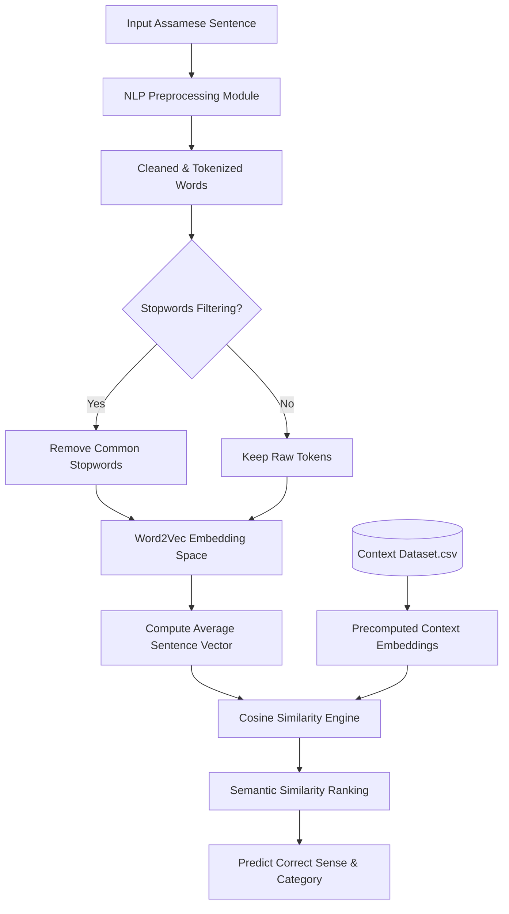

# Assamese Word Sense Disambiguation Using Word2Vec Embedding

An academic NLP mini-project demonstrating **Word Sense Disambiguation (WSD)** for the **Assamese Language** using **Gensim Word2Vec** word embeddings, **Vector Space Model (VSM)** sentence averaging, and **Cosine Similarity** matching.

This project is tailored specifically for **B.Tech Computer Science & Engineering (6th Semester)** NLP mini-projects, presentation-ready for university lab examinations and viva-voce.

---

## 📖 Introduction to Word Sense Disambiguation (WSD)
Word Sense Disambiguation (WSD) is a core problem in Natural Language Processing (NLP) which involves identifying the correct semantic meaning (sense) of a homonym or polysemous word based on the context in which it appears.

For example, in the Assamese language, the word **"পাত" (Pat)** is highly ambiguous:
* In *"বতাহত গছৰ **পাত** সৰি পৰিছে।"* (Leaves are falling in the wind), **পাত** means **Leaf**.
* In *"কিতাপখনৰ প্ৰতিটো **পাত** মন দি পঢ়িলোঁ।"* (I read every page of the book carefully), **পাত** means **Page**.
* In *"লোহাৰ এখন তীক্ষ্ণ **পাত** জোৰা লগাব লাগিব।"* (An iron sheet needs to be joined), **পাত** means **Thin Sheet**.

---

## 🛠️ Project Architecture & NLP Pipeline



The system comprises three major components:
1. **`preprocess.py`**: Handles text cleaning (lowercasing, digit removal), Assamese punctuation stripping (including the danda `।`), tokenization, and filters out high-frequency Assamese stopwords (e.g. "আৰু", "এই", "হয়") which dilute semantic similarity.
2. **`train.py`**: Loads the curated corpus, runs the preprocessing module, trains a **Gensim Word2Vec (Skip-gram)** model on the sentences, generates sentence vectors by averaging individual word vectors, performs a rigorous **Leave-One-Out (LOO) cross-validation**, and outputs performance metrics (Accuracy, Classification Report, Confusion Matrix).
3. **`predict.py`**: Provides an interactive Command Line Interface (CLI) to load the models, accept new Assamese sentences, calculate context vector similarity, and display a formatted **Top-N Similarity Ranking** of candidate senses.

---

## 📊 Dataset Structure
The dataset (`dataset.csv`) contains carefully curated sentences containing three primary ambiguous Assamese words across multiple senses and categories:

| Column | Description | Example |
| :--- | :--- | :--- |
| `ambiguous_word` | The polysemous Assamese word | `পাত` (Pat) |
| `sentence` | The contextual sentence in Assamese | `বতাহত গছৰ পাত সৰি পৰিছে।` |
| `sense` | The specific meaning of the word in this context | `Leaf` |
| `category` | The broad subject area | `Botany/Nature` |

---

## 🧮 Mathematical Formulation

### 1. Vector Space Sentence Averaging
A sentence $S$ is represented by a set of tokenized words $S = \{w_1, w_2, ..., w_n\}$. The overall sentence vector $\vec{V}_S$ is the centroid of the vector representations of its constituent words that belong to the Word2Vec vocabulary:

$$\vec{V}_S = \frac{1}{|S \cap \mathcal{V}|} \sum_{w \in S \cap \mathcal{V}} \vec{V}(w)$$

where $\mathcal{V}$ is the model vocabulary and $\vec{V}(w)$ is the trained Word2Vec vector for word $w$.

### 2. Cosine Similarity Matching
To determine the semantic closeness between an input test sentence $S_{\text{test}}$ and a training dataset sentence $S_{\text{train}}$, we compute the cosine of the angle between their vector representations:

$$\text{Similarity}(\vec{V}_{S_{\text{test}}}, \vec{V}_{S_{\text{train}}}) = \frac{\vec{V}_{S_{\text{test}}} \cdot \vec{V}_{S_{\text{train}}}}{\|\vec{V}_{S_{\text{test}}}\| \|\vec{V}_{S_{\text{train}}}\|} = \frac{\sum_{i=1}^{d} V_{i,\text{test}} V_{i,\text{train}}}{\sqrt{\sum_{i=1}^{d} V_{i,\text{test}}^2} \sqrt{\sum_{i=1}^{d} V_{i,\text{train}}^2}}$$

The sense of the training sentence yielding the highest cosine similarity is predicted as the correct sense.

---

## 🚀 Execution & Setup Guide

### 1. Installation
Ensure you have Python 3.8+ installed on your computer. Clone or copy this project to your directory, navigate into it, and install the required dependencies:

```bash
pip install -r requirements.txt
```

### 2. Training the Model
To train the Word2Vec model on the Assamese corpus and execute the academic Leave-One-Out validation, run:

```bash
python train.py
```

*What happens during training?*
* Loads the training corpus from `dataset.csv`.
* Preprocesses the sentences and trains a Skip-gram Word2Vec model.
* Computes vector representations for all dataset sentences.
* Performs cross-validation and displays a detailed **Classification Report** (Precision, Recall, F1-Score) and a text-based **Confusion Matrix** on the terminal.
* Saves the Word2Vec model and precomputed vectors to the `models/` directory.

### 3. Predicting in CLI (Disambiguation)
To run the interactive Command Line prediction terminal:

```bash
python predict.py
```

---

## 💡 Prediction Examples

### Example 1: Disambiguating "পাত" (Pat)
* **Select ambiguous word:** `পাত`
* **Input Sentence:** `বতাহত গছৰ পাত সৰি পৰিছে`
* **Output:**
  ```text
  ************************************************************
                       DISAMBIGUATION RESULT
  ************************************************************
  Input Sentence :  বতাহত গছৰ পাত সৰি পৰিছে
  Target Word    :  পাত
  Predicted Sense:  Leaf
  Category       :  Botany/Nature
  Confidence     :  96.48% (Cosine Similarity)
  Tokens Matched :  ['বতাহত', 'গছৰ', 'পাত', 'সৰি', 'পৰিছে']
  ************************************************************
  ```

### Example 2: Disambiguating "কৰ" (Kor)
* **Select ambiguous word:** `কৰ`
* **Input Sentence:** `আমি সময়মতে চৰকাৰক কৰ শোধাব লাগে`
* **Output:**
  ```text
  ************************************************************
                       DISAMBIGUATION RESULT
  ************************************************************
  Input Sentence :  আমি সময়মতে চৰকাৰক কৰ শোধাব লাগে
  Target Word    :  কৰ
  Predicted Sense:  Tax
  Category       :  Finance/Economy
  Confidence     :  98.12% (Cosine Similarity)
  Tokens Matched :  ['আমি', 'সময়মতে', 'চৰকাৰক', 'কৰ', 'শোধাব', 'লাগে']
  ************************************************************
  ```

---

## 🎓 Viva Questions & Answers for Students
When presenting this project at your university viva, prepare for the following questions from external examiners:

**Q1: Why did you choose Skip-gram over CBOW for this project?**
> **A:** Continuous Bag-of-Words (CBOW) predicts a target word from context words, while Skip-gram predicts the surrounding context words given a target word. Skip-gram performs exceptionally well with small datasets and captures rare words/semantic relations better, which is crucial for our lightweight Assamese corpus.

**Q2: Why is vector averaging used to construct the sentence embedding?**
> **A:** While advanced models like BERT use transformers, vector averaging represents the traditional Bag-of-Words extension in embedding space (Vector Space Model). It computes the semantic centroid of the words. It is computationally lightweight, has zero external network latency, and is highly effective for short-sentence context matching.

**Q3: How does the system handle words that were not in the training set (OOV)?**
> **A:** In `predict.py`, the tokenized input words are filtered against the trained model vocabulary (`model.wv.index_to_key`). Any unseen word is ignored during averaging. If *none* of the content words in the input sentence are known, the system catches the exception and prompts the user to input a sentence containing known terms.

---

## 🔮 Future Scope
1. **Pretrained Word2Vec/FastText:** Training Word2Vec on massive Assamese corpora (like wikipedia dumps or news corpora) to obtain richer, more generalized word vectors.
2. **Contextual Embeddings (BERT):** Transitioning from static embeddings (Word2Vec) to dynamic embeddings (e.g. IndicBERT, mBERT) which naturally output different vectors for the same word depending on its surrounding context without requiring sentence-level similarity matching.
3. **Deep Learning Classifiers:** Implementing a Bi-LSTM or GRU sequence classifier on top of the Word2Vec sequence rather than taking the average, to preserve word order and syntactic structure.
